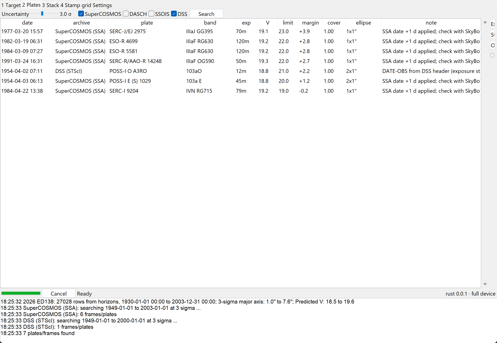
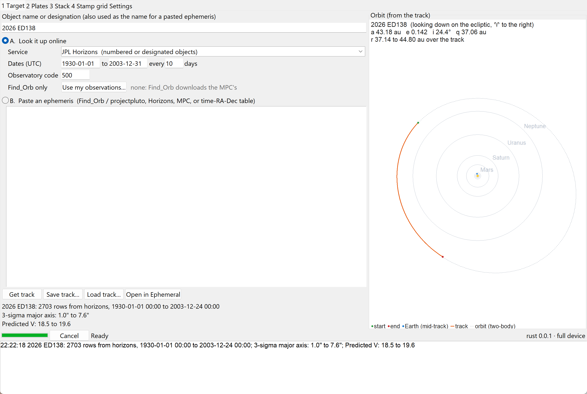
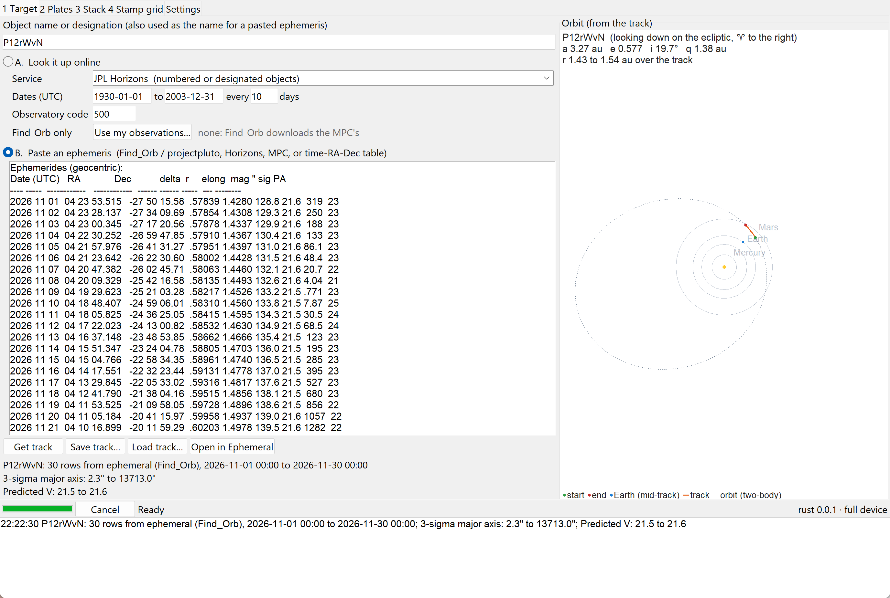
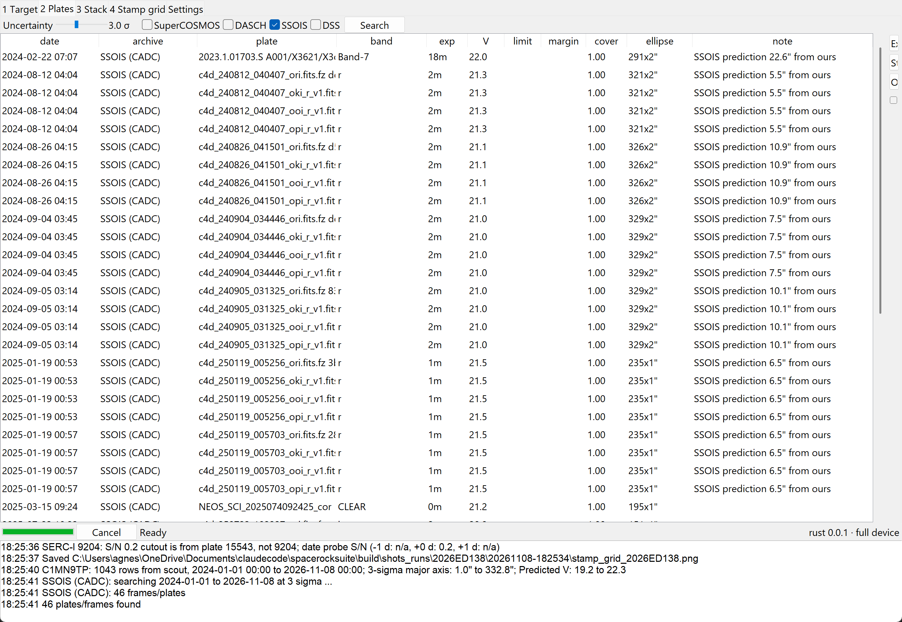
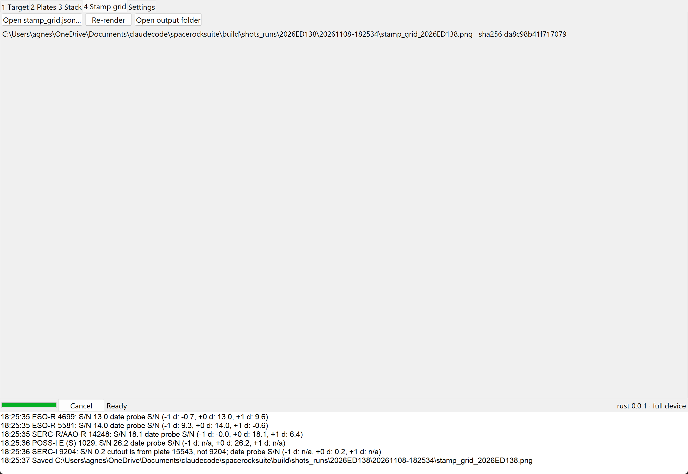
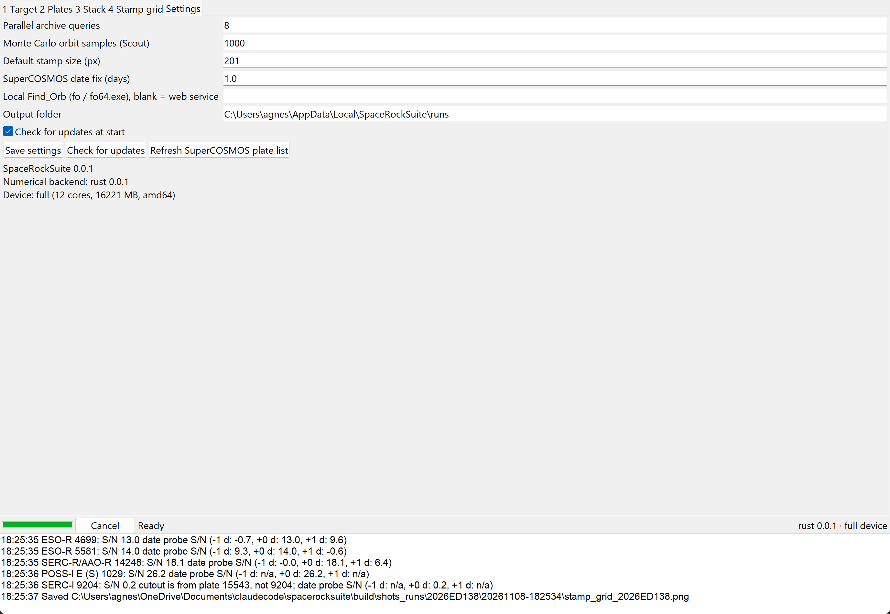
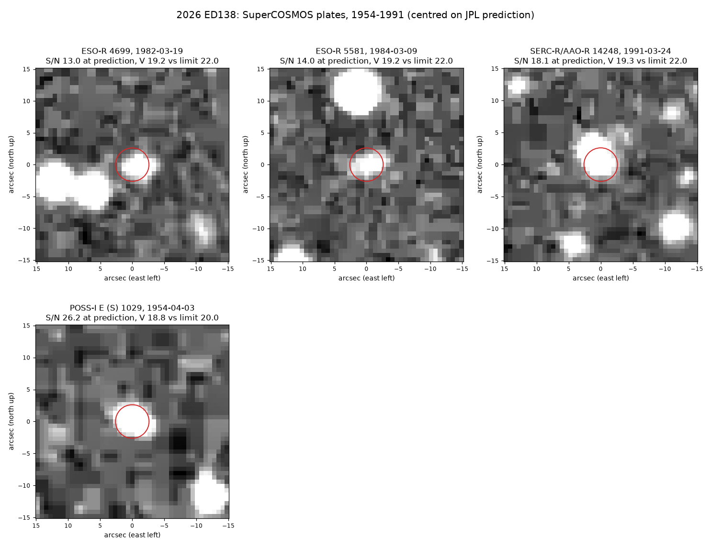
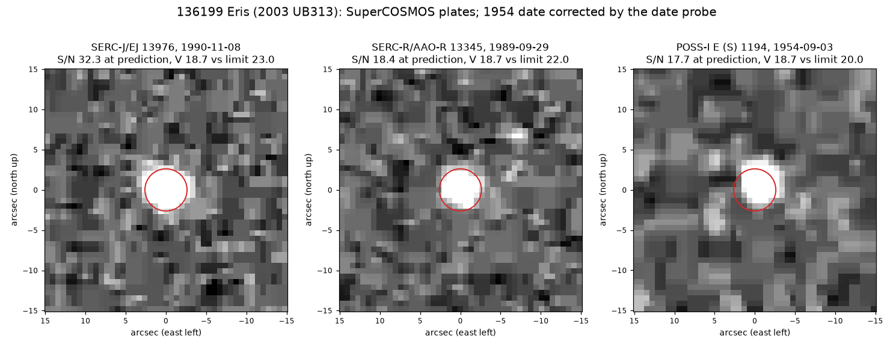

# SpaceRockSuite

[](https://github.com/eagnespuerto/spacerocksuite/actions/workflows/ci.yml)
[](https://github.com/eagnespuerto/spacerocksuite/releases)
[](#install)
[](pyproject.toml)
[](rust/)
[](spacerocksuite/gui/app.py)
[](https://eagnespuerto.github.io/ephemeral/)
[](https://doi.org/10.5281/zenodo.24052319)
[](LICENSE)

**A desktop app for precovery of asteroids, comets and TNOs.** Give it an object. It gets the orbit and its uncertainty, finds old plates and survey frames that should contain the object, cuts stamps at the predicted position, and makes a stamp grid. It runs on Windows, Linux and Raspberry Pi OS, and it is light enough for a Pi 3B+.



## What it does

1. **Track.** It gets an ephemeris with its error ellipse from one of four sources:
   - **JPL Horizons** (with the 3σ ellipse, quantities 36 and 37);
   - **JPL Scout**, for objects on the NEO Confirmation Page, built from Scout's orbit samples;
   - **Find_Orb**, run locally if you have it, or through Bill Gray's web service, using MPC observations or your own;
   - **a pasted ephemeris**: copy the table from Find_Orb on projectpluto.com, Horizons or the MPC, or a plain time/RA/Dec table, and paste it in. Find_Orb's sigma, PA and magnitude are kept.

   Beside it, the app draws the track as an orbit seen from above the ecliptic, with the planets' orbits and a two-body orbit through the track. Any track opens in [Ephemeral](https://eagnespuerto.github.io/ephemeral/) with one click.
2. **Plates.** It searches archives for plates whose field covers the object at that plate's own epoch, within an uncertainty you set from 1σ to 6σ:
   - **SuperCOSMOS**: UKST/SERC, ESO Schmidt, POSS-I and POSS-II, 6,646 plates. This search runs offline from a bundled plate list.
   - **DASCH**: Harvard plates, 1885–1992.
   - **CADC SSOIS**: frames from about 40 telescopes, 1990 to now.
   - **STScI DSS**: the POSS-I blue plates, the one plate set SuperCOSMOS lacks.

   Results come ranked by how deep each plate goes compared with the predicted magnitude.
3. **Stamps and clean-ups.** It cuts each stamp north-up and centred on the prediction. Then it applies the same clean-ups used for 2026 ED138:
   - median background subtraction;
   - Gaussian matched filter;
   - template subtraction;
   - a least-squares (design-matrix) fit that removes nearby stars and deblends a blended target;
   - round or elliptical Gaussian centroids;
   - noise measured from random empty apertures, with correction for the 2×2-correlated noise of plate scans.
4. **Stacks and shift-stacks.** You can stack frames on a fixed position, shift-stack them along the predicted track, or stack them along a set rate for synthetic tracking. Noise comes from control tracks. Null tests repeat the stack with reversed, zero, rotated and doubled motion, so you can tell a real mover from a star residual.
5. **Stamp grids.** These are made without Claude Code, and the output is deterministic. The stamp-grid skill's house style and `stamp_grid.json` format are built in, so old specs still work. The same spec and data give the same PNG bytes every time.

## Why

Before this, my precovery work for 2026 ED138 and 2026 EE138 lived in dozens of one-off scripts run through Claude Code. SpaceRockSuite puts the parts that worked into one program that anyone can run without Claude Code.

## Install

Download from [Releases](https://github.com/eagnespuerto/spacerocksuite/releases).

| System | File | How |
|---|---|---|
| Windows 10/11 (64-bit) | `SpaceRockSuite-x.y.z-setup.exe` | Run it. No admin rights needed. A portable `.zip` is there too. |
| Linux (x86_64) | `spacerocksuite-x.y.z-linux-x86_64.tar.gz` | Unpack it, then run `sh install.sh` |
| Raspberry Pi OS 64-bit | `spacerocksuite-x.y.z-linux-arm64.tar.gz` | Unpack it, then run `sh install.sh` |
| Raspberry Pi OS 32-bit (e.g. Pi 3B+) | `spacerocksuite-x.y.z-linux-armv7.tar.gz` | Unpack it, then run `sh install.sh` |

On Linux and the Pi, `install.sh` uses the system's own NumPy, Astropy, Matplotlib and Tk packages. These come prebuilt from apt, so nothing heavy compiles on the Pi. The script then puts the app in a small venv and adds a menu entry. After installing, run `spacerocksuite-gui` for the window or `srs` for the command line.

**Updates.** The app checks GitHub Releases when it starts. It downloads nothing until you say yes. You can also run `srs update`.

From source (any OS with Python 3.9+):

```bash
pip install git+https://github.com/eagnespuerto/spacerocksuite
```

The Rust core is optional. Without it the app uses NumPy versions of the same functions, which give the same numbers more slowly. To build the core, you need a Rust toolchain:

```bash
pip install maturin && maturin build --release -m rust/Cargo.toml -o wheelhouse && pip install wheelhouse/srs_core-*.whl
```

## It adjusts to your device

At start-up the app reads the core count, RAM and board model (Pi detection uses `/proc/device-tree/model`), then picks one of three tiers:

| Tier | Example | Parallel queries | Orbit samples | Default stamp |
|---|---|---|---|---|
| light | Pi 3B+ (1 GB) | 3 | 200 | 101 px |
| medium | Pi 4/5, small laptop | 5 | 500 | 151 px |
| full | desktop | 8 | 1000 | 201 px |

You can change each value in **Settings**. Heavy loops (two-body propagation of orbit clouds, shift-and-add, median and Gaussian filters) run in Rust and release Python's GIL. The SuperCOSMOS search needs no network.

## Using it

The window has four steps, plus Settings:

1. **Target**: type the object's name. Then either **A**, look it up online (Horizons for numbered or designated objects, Scout for NEOCP objects, Find_Orb to fit observations) with a date range, or **B**, paste an ephemeris, for example the Find_Orb table from projectpluto.com. Clicking in a section picks it. Press *Get track*; the orbit sketch appears on the right.
2. **Plates**: set the uncertainty (1–6σ) with the slider, tick the archives you want, then press *Search*. Select rows and press *Stamps of selected* for SuperCOSMOS or DSS. Other archives open their own page.
3. **Stack**: add FITS frames, choose *track* (shift-stack) or *static*, and set the clean-ups. Null tests are on by default.
4. **Stamp grid**: grids show up here. *Open stamp_grid.json* re-renders any spec.

The same steps work from the command line, which helps over SSH on a Pi:

```bash
srs track "2026 ED138" 1950-01-01 2003-12-31 -o ed138.json
```

```bash
srs plates ed138.json --sigma 3 --archives SuperCOSMOS DASCH -o plates.csv
```

```bash
srs stamps ed138.json plates.csv --top 9 -o ed138_stamps
```

```bash
srs stack ed138.json frames/*.fits --mode track --bkg 41 --null
```

```bash
srs grid ed138_stamps/stamp_grid.json
```

## Screenshots

| | |
|---|---|
|  |  |
| **Target, look-up.** A Horizons track for 2026 ED138, 1930–2003, drawn as an arc of its orbit (a 43.2 au, e 0.14, i 24.4°). | **Target, paste.** A Find_Orb ephemeris for NEOCP object P12rWvN, pasted from projectpluto.com. |
|  |  |
| **Plates.** Seven plates at 3σ, ranked by limit minus predicted V. | **SSOIS frames** for NEOCP object C1MN9TP, searched with Scout's orbit. |
|  |  |
| **Stamp grid.** Each grid shows its file path and SHA-256. | **Settings.** Defaults come from the device tier. You can change them. |

## Test runs

I checked the app against three kinds of object.

**Dwarf planet candidate: 2026 ED138 (Horizons).** At 3σ, the offline SuperCOSMOS search finds every plate from the ED138 precovery notes: POSS-I E 1029 (1954-04-03), ESO-R 4699 (1982-03-19), ESO-R 5581 (1984-03-09) and UKST R 14248 (1991-03-24). The object shows on the stamps at S/N 13–26. It also finds SERC-J 2975 (1977-03-20), which matches a 1977 position already in the MPC database. DASCH turns up plate mc27133 (1934), SSOIS returns the VISTA/VVV frames of 2010, and DSS lists the POSS-I blue plate taken the night before E 1029.



**Numbered object: (136199) Eris (Horizons).** The search lists the UKST plates of 1989–1997 and the 1954 POSS-I plates that Eris was precovered on. With the +1 day fix, the UKST plate times match the MPC's archived positions to within minutes. The 1954 POSS-I E plate 1194 does not match: Eris is on it at S/N 17.7 only for 1954-09-03, two days after the SSA date. The date probe finds this on its own and moves the plate date. The MPC's 1954 positions are dated 09-03 too.



**NEOCP objects (Scout).**
- **C1MN9TP** (q = 3.9 au, e = 0.45): SSOIS, searched with Scout's orbit, returns 13 exposures from 2024–2025, mostly DECam. SSOIS's predictions land 5–23″ from ours.
- **A11IrUa** and **A11HAVq** (e ≈ 1.00): neither SSOIS route works for these. SSOIS's element search needs an elliptic orbit, and its arc fitters fail on them. The app logs this and goes on to the other archives.
- **6L71921** (0.3-day arc): its 3σ ellipse a year back is thousands of degrees wide. The app skips that search and logs why.

## Things to know

- **SuperCOSMOS dates.** SSA plate dates are often one day early (2026 ED138, checked against known asteroids) and sometimes two (Eris, POSS-I 1194). The app adds +1 day by default (see Settings). Each SuperCOSMOS stamp is also measured at −1, 0 and +1 day from that. The date moves only when one trial is clearly best: S/N ≥ 5 and at least twice the others. All three values go in the log. For faint objects with no detection, the probe can't help. Check with [SkyBoT](https://ssp.imcce.fr/webservices/skybot/) before you send anything to the MPC.
- **Plate cutouts.** The SSS cutout server serves one plate per band, and that is not always the plate you picked. When this happens, the app warns you ("cutout is from plate …").
- **Scout clouds.** Clouds from short arcs have heavy tails. The nσ ellipse is scaled so it holds the same share of samples as a Gaussian would (39%, 86%, 99%, …). Because of this, 3σ and above can be much larger than 1σ.
- **Find_Orb sigmas.** Find_Orb gives the 1σ major axis only, so the app uses a circle of that radius. The search may cover more sky than it needs to.
- **Near-parabolic NEOCP objects.** SSOIS can't search these yet (see Test runs). The offline plate archives still work for them.
- **DASCH speed.** Each DASCH query returns thousands of plates. A track spanning decades means hundreds of queries and can take a long time. Answers are cached for 30 days, so later runs are fast. Search a shorter span first.
- **Two-body orbits.** Scout tracks use two-body propagation over the dates you ask for. For long arcs, use Horizons or Find_Orb, which are n-body.
- **SARC.** Archival astrometry has to go through the MPC's SARC process. The app finds and measures plates; it does not submit anything.

## Layout

```
spacerocksuite/
  services/     horizons.py, scout.py, findorb.py, mpc.py, ephemeral.py
  archives/     supercosmos.py (offline), dasch.py, ssois.py, dss.py
  imaging/      cleanup.py, stack.py, stampgrid.py
  track.py      tracks, error ellipses, sigma scaling
  orbit_view.py orbit sketch for the Target tab (two-body fit, Tk canvas)
  precovery.py  the pipeline the GUI and CLI share
  core.py       Rust core with NumPy fallbacks
  device.py     device tiers
  updater.py    GitHub Releases updater
  gui/app.py    Tkinter window
rust/           srs_core (PyO3): Kepler solver, shift-stack, filters
packaging/      PyInstaller spec, Inno Setup script, Linux/Pi install.sh, icon
tests/          offline tests; both backends must agree
```

## How to cite

Puerto, E. A. (2026). *SpaceRockSuite: a precovery toolkit for asteroids, comets and TNOs* (Version 0.0.2) [Computer software]. Zenodo. https://doi.org/10.5281/zenodo.24085303

To cite all versions, use the concept DOI [10.5281/zenodo.24052319](https://doi.org/10.5281/zenodo.24052319). GitHub's "Cite this repository" button reads [CITATION.cff](CITATION.cff).

## Credits

- [JPL Horizons, SBDB and Scout](https://ssd.jpl.nasa.gov/) (NASA/JPL); [Find_Orb](https://www.projectpluto.com/find_orb.htm) by Bill Gray; [Minor Planet Center](https://minorplanetcenter.net/) observations.
- Plates and frames: [SuperCOSMOS Science Archive](http://ssa.roe.ac.uk/) (WFAU, Edinburgh), [DASCH](https://dasch.cfa.harvard.edu/) (Harvard), [CADC SSOIS](https://www.cadc-ccda.hia-iha.nrc-cnrc.gc.ca/en/ssois/), [STScI DSS](https://archive.stsci.edu/cgi-bin/dss_form).
- Icon: "meteor" from [Phosphor Icons](https://phosphoricons.com) (MIT).
- Built with NumPy, Astropy, Matplotlib, PyO3 and Rayon.

## Use of AI tools

I wrote this with substantial help from Claude (Anthropic; Claude Opus 5.5 through Claude Code). Two Ollama cloud models (gpt-oss:120b and nemotron-3-ultra) drafted the ephemeris-parser port and a first Rust draft. I rewrote and tested both. I direct the project and am responsible for it.

## License

[MIT](LICENSE) © 2026 Ella Agnes Puerto
